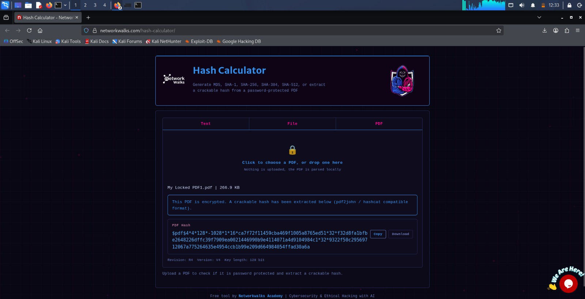
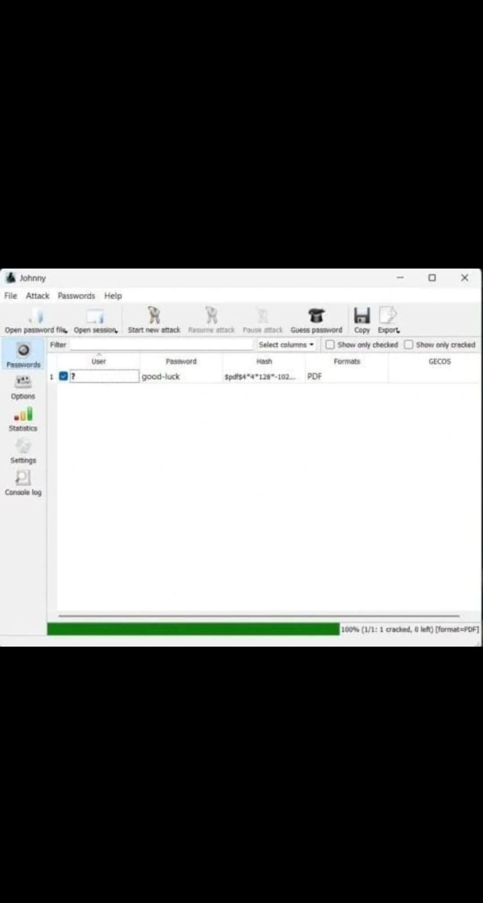
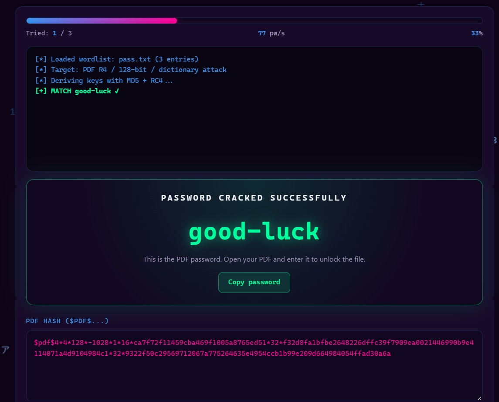
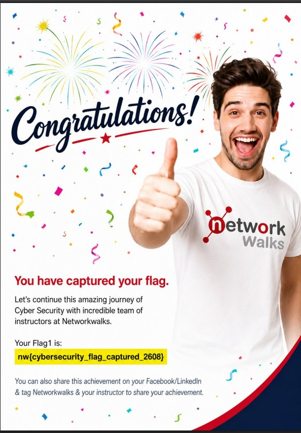

<div align="center">

# Password Cracking Report

### Offline PDF Password Cracking with John the Ripper (JTR)


</div>

---

## Report Details

| Field | Information |
| :--- | :--- |
| **Pentester** | Nived Poduval |
| **Batch** | B084 |
| **Module** | W3-PM (Password Cracking — John the Ripper) |
| **Target** | Locked PDF (`My Locked PDF1.pdf`) |
| **Permission** | Granted by Networkwalks |

---

## Disclaimer

> **Warning:** All activities documented in this repository were performed strictly on password-protected files provided specifically for this exercise, with prior permission granted by Networkwalks. This documentation is intended solely for educational and research purposes. Unauthorized password cracking or accessing files without explicit authorization is prohibited by law.

---

## Overview

This project demonstrates offline password cracking methodologies against encrypted PDF documents. The workflow transitions from extracting a crackable cryptographic hash using `pdf2john` to cracking it offline with John the Ripper (via the Johnny GUI) and verifying the recovered credentials using Networkwalks online tools.

---

## Tools Used

- **Kali Linux**: Operating system environment used for security testing and hash processing.
- **pdf2john**: Utility script used to parse encrypted PDF documents and extract crackable hash signatures.
- **John the Ripper (JTR)**: Fast password cracker used to execute offline dictionary attacks.
- **Johnny GUI**: Graphical interface for John the Ripper to configure attacks and inspect cracked hashes.
- **Networkwalks Hash Calculator / Cracker**: Online utility suite used for hash extraction verification and password validation.

---

## Phase 1 & 2: Hash Extraction & Offline Cracking (JTR)

### Hash Extraction
The encryption metadata and password hash were extracted from the locked PDF file:
```bash
pdf2john My-Locked-PDF1.pdf > pdf.hash
```
The extracted hash conforms to the `$pdf$4*4*128*...` format (Revision 4, Version 4, 128-bit key length), confirming MD5/RC4 key derivation.

<p align="center">
  
</p>

### Offline Password Recovery
The hash file was loaded into John the Ripper (Johnny GUI) to run a dictionary attack:
```bash
john pdf.hash
```
The attack completed in a single pass, cracking the hash and revealing the plaintext password: **`good-luck`** (100% completed, 1/1 cracked).

<p align="center">
  
</p>

---

## Phase 3: Online Verification & Flag Capture

The extracted hash was also verified using the Networkwalks online cracking tool. The dictionary attack matched the password `good-luck` instantaneously. Unlocking the PDF with the recovered password revealed the completion flag:

- **Captured Flag:** `nw{cybersecurity_flag_captured_2608}`

<p align="center">
  
</p>

<p align="center">
  
</p>

> *Note: A full technical report and methodology documentation are available if needed.*

---

## Security Takeaways

- **Password Strength Over Encryption:** Even with 128-bit document encryption, passwords based on common dictionary words or phrases can be recovered rapidly once the hash is extracted.
- **Defensive Recommendations:** High-value documents should enforce long, high-entropy passwords and utilize modern AES-256 encryption standards.

---

## Repository Contents

- `Hashcalculator.jpg`: Networkwalks Hash Calculator output showing extracted PDF hash parameters.
- `Passwordcrackedusingjonny.jpg`: Johnny GUI interface showing the cracked password (`good-luck`).
- `Passwordcracked.jpg`: Online verification tool displaying the cracked password.
- `Capturedflag.jpg`: Flag capture confirmation from the unlocked PDF.
- `My-Locked-PDF1.pdf`: Password-protected sample PDF file used for the exercise.

---

## Author

**Nived Poduval**  
Cybersecurity & Ethical Hacking Internship · Networkwalks (Batch B084)
